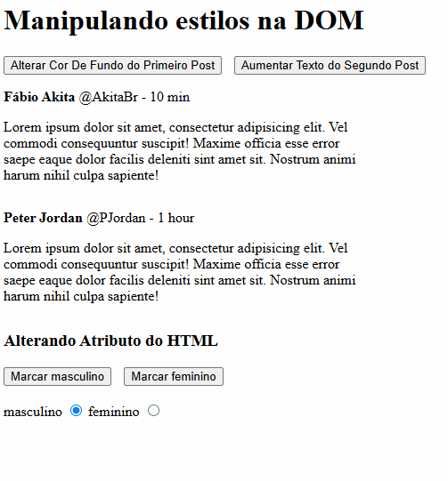

# Practice DOM 01
Primeiro exercicio pratico de manipulação da DOM no js.

## 📍 Live Demo
Veja o projeto no seu navegador:

<a href=""><strong>🔗 Click to View</strong></a>

## Tecnologias Utilizadas
- **HTML5:**

- **CSS3**
- **JS** 

## Visou aplicar:
-  **Eventos de clique no HTML:** Chamam as funções 'alterarCor' e 'aumentarTexto'
- **Captura de Elementos:** Por meio do `getElementsByClassName` e `getElementById`.
- **Alteração do style pela DOM**: Na função `alterarCor` o primeiro comentário recebe a cor 'coral' após o evento de clique ocorrer.
- **classList.add**: Quando a função `aumentarTexto` é chamada, a classe `fonte-aumentada` será adicionada ao segundo comentário, fazendo com que a propriedade css dessa classe seja aplicada ao elemento.
- **Alterar propriedade HTML pela DOM**: A função `marcarGenero` adiciona a propriedade `checked` aos inputs de radio 'masculino' ou 'feminino' de acordo com o valor que for passado como parametro.

## Layout Preview

 
